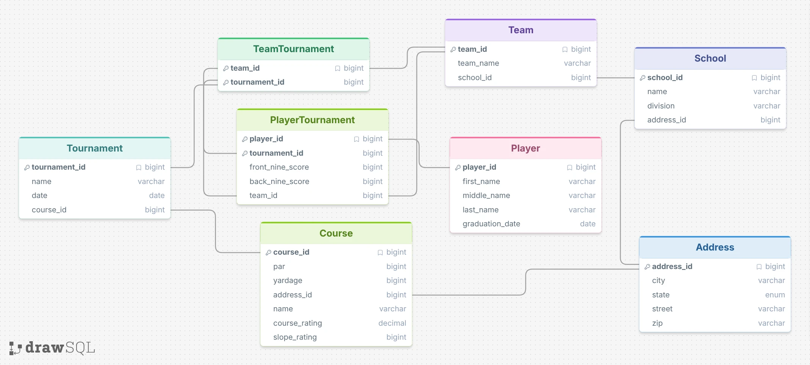

# AI SQL Project - Owen Larson

## Description

My database is a golf tournament database. I played golf in highschool so I mostly modeled it off high school golf. It tracks players, what school/team they play for, what tournaments they have played in, and what they scored in those tournaments.

## Picture of Schema


## Question/Response that worked

Question: Which players withdrew before finishing a round?

SQL Response (from zero shot):
```sql
SELECT p.player_id, p.first_name, p.middle_name, p.last_name, pt.tournament_id
FROM player p
JOIN player_tournament pt ON p.player_id = pt.player_id
WHERE pt.front_nine_score IS NULL OR pt.back_nine_score IS NULL;
```

The AI correctly determined that if either the back nine or front nine score was null that the player withdrew.

## Question/Response that did not work

Question: Which player won the most tournaments?

SQL Response (from zero shot):
```sql
SELECT p.first_name, p.last_name, COUNT(pt.tournament_id) AS tournament_wins
FROM player p
JOIN player_tournament pt ON p.player_id = pt.player_id
GROUP BY p.player_id
ORDER BY tournament_wins DESC
LIMIT 1;
```

Both strategies returned SQL that incorrectly determined 'winning' a tournament as playing in a tournament. Maybe the AI needed to be informed on the rules of golf in every query so that it would know to find the player with the lowest score in the most amount of tournaments.

## Other Examples

Other examples can be found in the `response_zero_shot.json` and `response_single_domain_double_shot.json` files respectively.

## Prompting Strategies

I used the zero shot and single domain prompting strategies. In general, there was essentially no difference in the SQL that was generated from these two prompting strategies. There was one question: "Which players have played for more than one team?" where the zero shot strategy got the answer correctly, and double shot got it incorrect. This was because of an incorrect JOIN for the double shot version of the query. Because this was the only significant difference, I don't think it necessarily means zero shot is better, I think this is just random noise. 

I did find it interesting that both of these strategies did not perform very well, and got multiple of the questions wrong. Also, both strategies were getting the same questions wrong in the same way. I think the models probably needed more context to what the database was about, and maybe about some of the rules of golf as well.